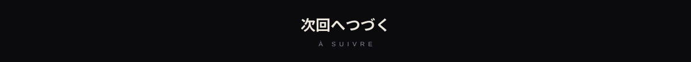

<a href="https://github.com/Egld-Rma/Yakuza4-Remastered-FR"><b>Télécharger Yakuza 4 Remastered FR</b></a>

Dans Yakuza 3 Remastered, les résumés de Yakuza 1 et 2 avaient disparu du menu titre. **[Yakuza 3 Recaps Restored](https://github.com/Egld-Rma/Yakuza3-Recaps-Restored)** les remet en place : on glisse les fichiers dans le dossier du jeu, et c'est tout.

<table>
<tr>
<td width="70%" align="center" valign="middle">
Discord : <b>egld</b>  

</td>
<td width="30%" align="center" valign="bottom">

</td>
</tr>
</table>

